# تقرير التحقق من نظام الكافيه والمخزون — ONE80

**تاريخ الاختبار:** 18 يوليو 2026  
**المشروع:** `/Users/fatmaatefkasem/Desktop/nomany_hr/GYM/one80`  
**قاعدة البيانات:** `one80_hr` المنفصلة  
**النطاق:** الكافيه، المخزون، المشتريات، مديونية الموردين، الجرد، الحركات، التقارير.

## النتيجة التنفيذية

- تم تطبيق جميع migrations الخاصة بـ ONE80، وعددها 27، ولا توجد migrations معلّقة.
- نجح Production Build للواجهة الأمامية (`tsc -b && vite build`).
- نجح Production Build للـ backend (`nest build`).
- تم فتح واختبار 13 شاشة فعلية من شاشات دورة الكافيه، ولم يظهر خطأ قاعدة بيانات في أي منها.
- سجل المتصفح بعد الاختبار لا يحتوي على أخطاء أو تحذيرات Console.
- تم تنفيذ دورة شراء فعلية محلية بمبلغ 100 ج.م، والمدفوع 40 ج.م، فزاد المخزون وتحدّث متوسط التكلفة وسُجلت مديونية 60 ج.م وحركة مخزنية باسم المستخدم.
- تم تنفيذ سداد مورد فعلي بقيمة 20 ج.م، فانخفضت المديونية من 60 إلى 40 ج.م، وتم تحديث آخر سداد والخزينة تلقائيًا.
- لم يتم تعديل هوية ONE80 أو ألوانها أو شعارها، ولم يتم لمس بيانات الأعضاء أو الاشتراكات.

## بيانات الاختبار المحلية

كل البيانات المضافة مميزة بالبادئة `E2E-CAFE` حتى يسهل حذفها من قاعدة ONE80 المحلية فقط:

- الفئة: `E2E-CAFE مشروبات اختبار`
- الخامة: `E2E-CAFE كاكاو أونصة`
- المورد: `E2E-CAFE مورد الاختبار`
- المستودع: `E2E مخزن اختبار الكافيه`
- فاتورة الشراء: `SINV-000001`

## نتائج الصفحات

| الصفحة | التحقق | النتيجة |
|---|---|---|
| فئات الكافيه | الفئات تنظّم تبويبات نقطة البيع والتقارير ولا تُستخدم للخامات | ناجح |
| خامات الكافيه | لا يوجد سعر بيع؛ يوجد تنبيه كمية قابل للتعديل، ومتوسط تكلفة، ووحدات `oz` و`fl oz` | ناجح |
| منتجات الكافيه | نموذج الصورة والوصفة والتكلفة والربح، والأنواع الثلاثة: محضّر للبيع، تصنيع داخلي، جاهز | ناجح |
| قائمة الأسعار | تعرض المنتجات القابلة للبيع فقط، وتوضح أن التعديل ينعكس فورًا في نقطة البيع | ناجح |
| الموردون | إنشاء مورد وربطه بالخامات التي يوفرها | ناجح |
| المشتريات | فلترة خامات المورد، عرض الموجود، الكمية، إجمالي الدفعة، سعر الوحدة المحسوب، المدفوع والمتبقي | ناجح فعليًا |
| مديونية الموردين | إجمالي المشتريات والمدفوع والمتبقي وآخر سداد، مع توزيع السداد على الأقدم | ناجح فعليًا |
| إيصال بيع جديد | شاشة بيع واحدة، عميل/موظف/شريك، سلة ودفع، بدون أي منطق ورديات | ناجح واجهة وربط |
| الجرد | بداية اليوم والوارد والمنصرف والمبيعات/الاستهلاك والإغلاق والموجود الآن مع فلاتر | ناجح |
| سجل الحركات | ماذا حدث، التأثير، الرصيد بعد، المصدر/المستند، والمستخدم المنفذ | ناجح |
| لوحة المخزون | الأصناف والمستودعات والقيمة والمنخفض والوارد والمنصرف والحركات والتحليلات | ناجح |
| صرف داخل الجيم | تحويل بين المخازن بدون معاملة مالية | ناجح |
| تقارير الكافيه | المبيعات والربح والمشتريات والمديونية وأنواع البيع واستهلاك الشركاء | ناجح |

## التحقق من القواعد المطلوبة

1. **الخامات:** لا يوجد حقل سعر بيع، لأن الخامة مخزون وليست منتجًا للبيع. متوسط التكلفة يتغير من المشتريات فقط.
2. **تنبيه الكمية:** موجود وقابل للتعديل، ويظهر تنبيه شراء عندما يساوي الرصيد الحد أو يقل عنه.
3. **الأونصة:** وحدتا `oz` و`fl oz` ظاهرتان في نموذج الخامة.
4. **المنتجات:** الأنواع الثلاثة متاحة بوضوح، والمنتج الداخلي لا يُعرض في نقطة البيع.
5. **الوصفة:** يمكن إضافة مكون أو إنشاء خامة غير موجودة من داخل النموذج، والتكلفة والربح والهامش محسوبة تلقائيًا.
6. **المشتريات:** الخامات تُفلتر حسب المورد، وسعر الوحدة يُحسب من `(قيمة الدفعة ÷ الكمية)`.
7. **المخزون:** فاتورة الاختبار رفعت رصيد الخامة من 0 إلى 10 أونصات وسجلت الحركة.
8. **المديونية:** فاتورة 100 ومدفوع 40 أنتجت مديونية 60، ثم سداد 20 جعل المتبقي 40.
9. **الوردية:** لا تظهر أي رسالة أو حقل أو اعتماد على وردية في شاشة البيع؛ التسجيل باسم المستخدم الحالي.
10. **التقارير:** شراء الاختبار انعكس مباشرة في لوحة المخزون والجرد والحركات وتقارير الكافيه.

## أدلة الواجهات

### الفئات والخامات

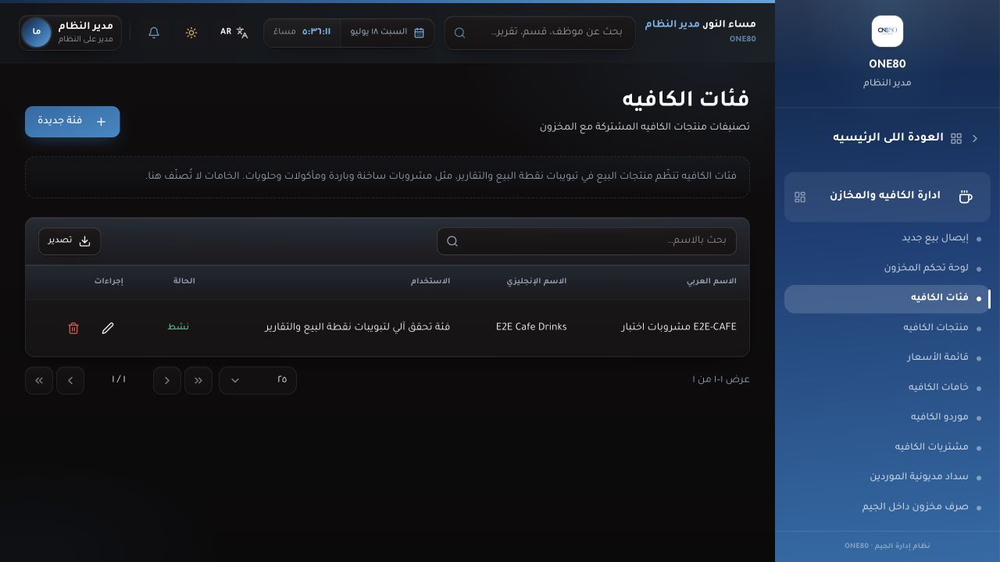

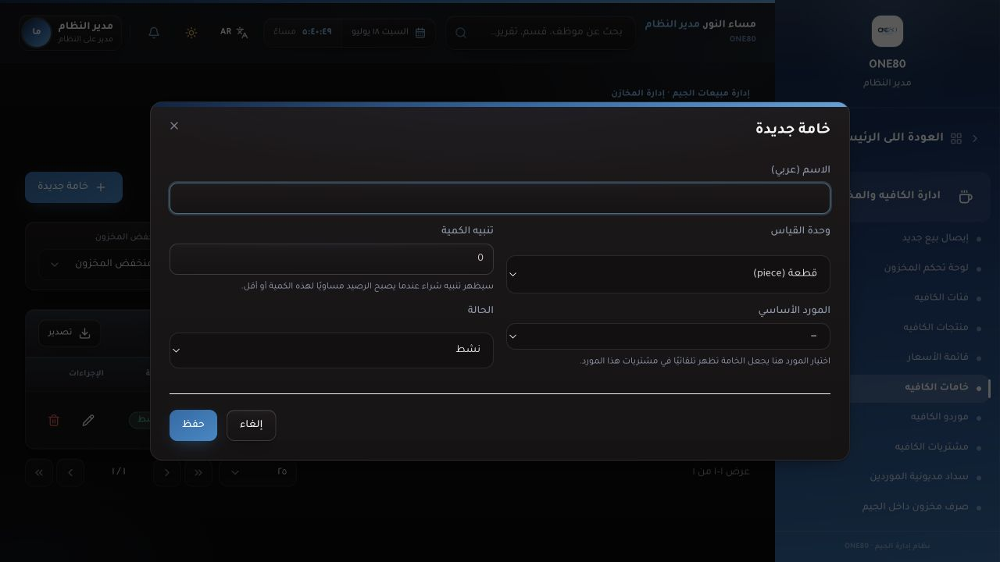

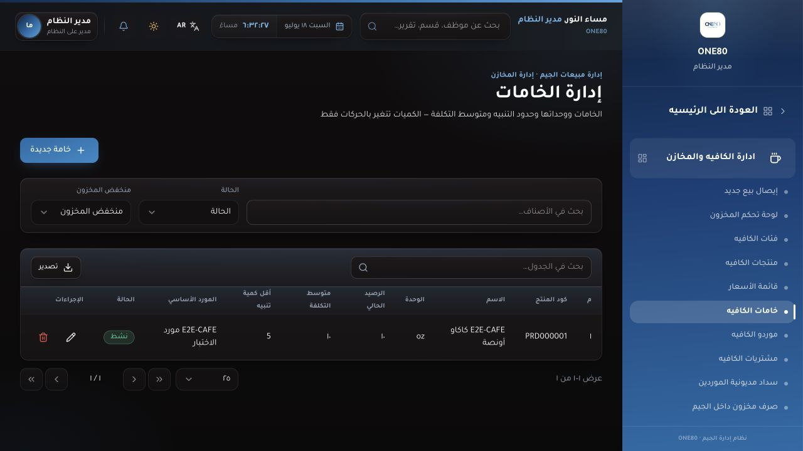

### المنتجات والأسعار

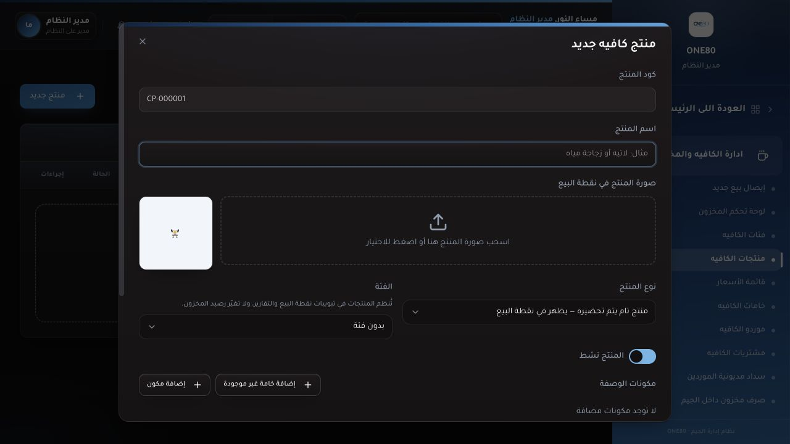

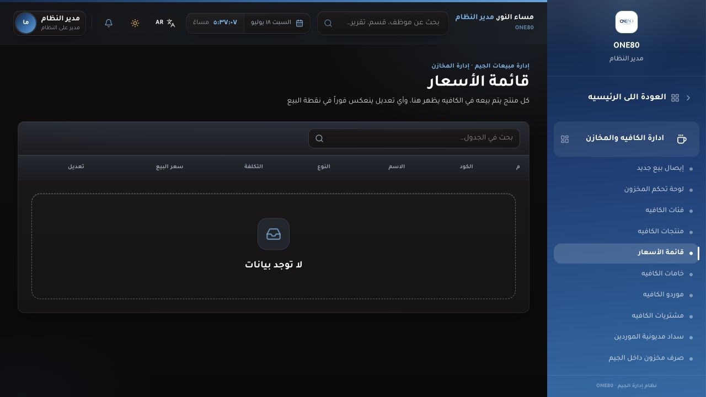

### المشتريات والمديونية

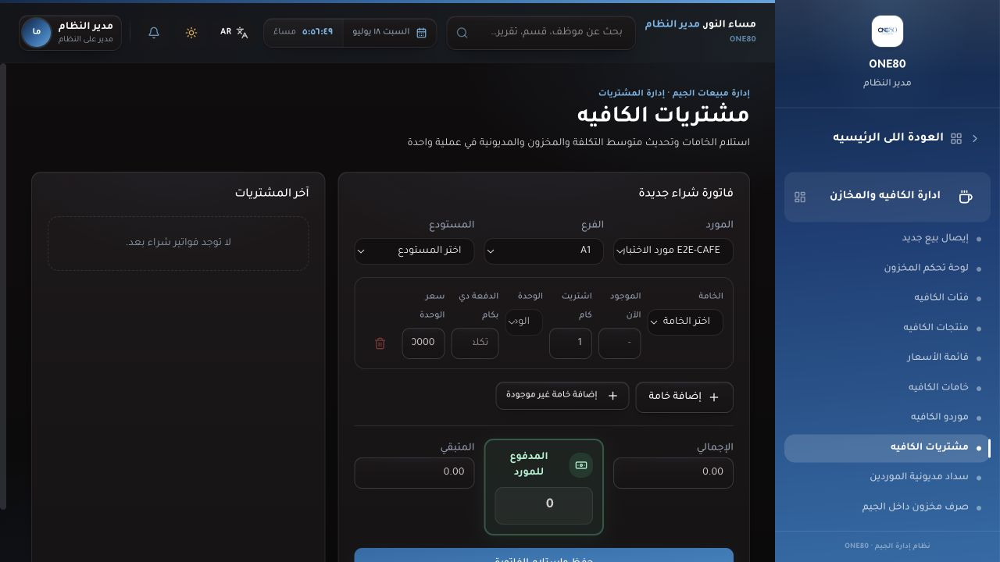

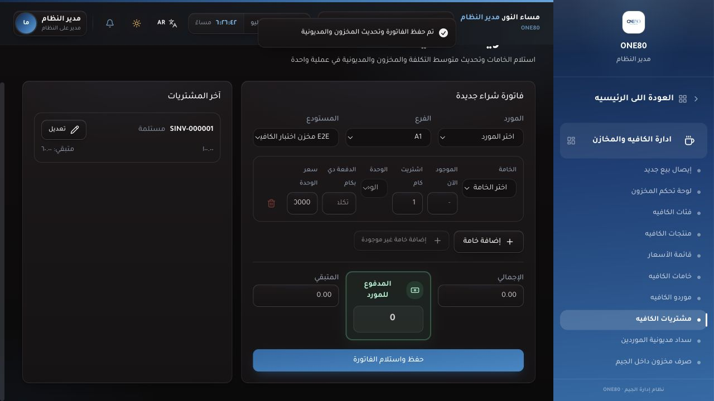

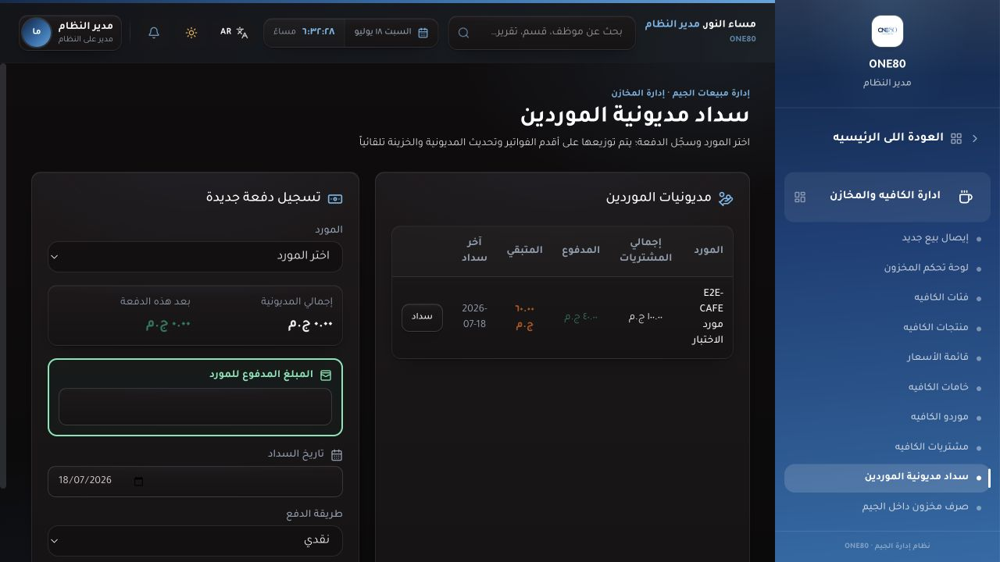

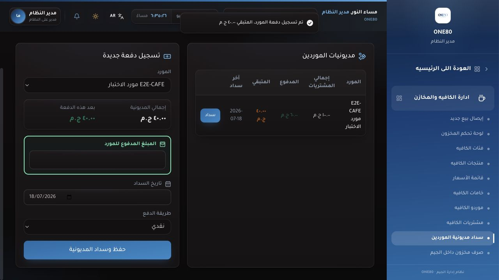

### البيع والمخزون

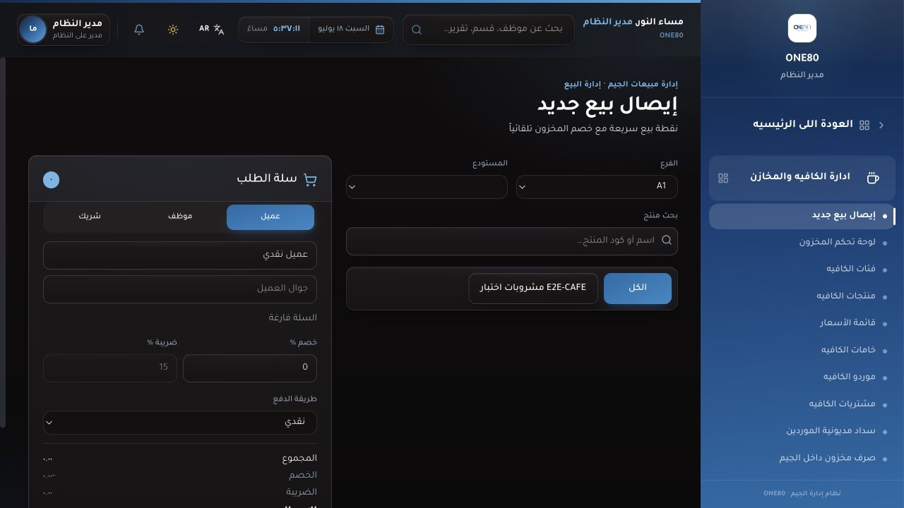

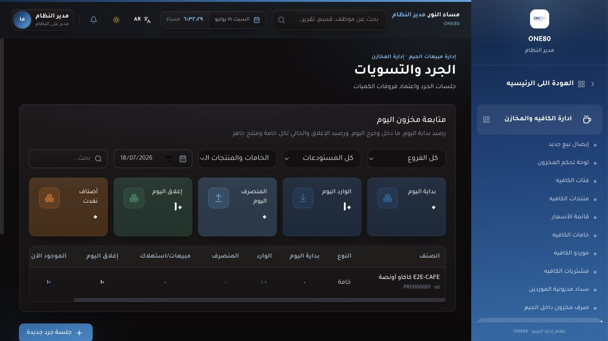

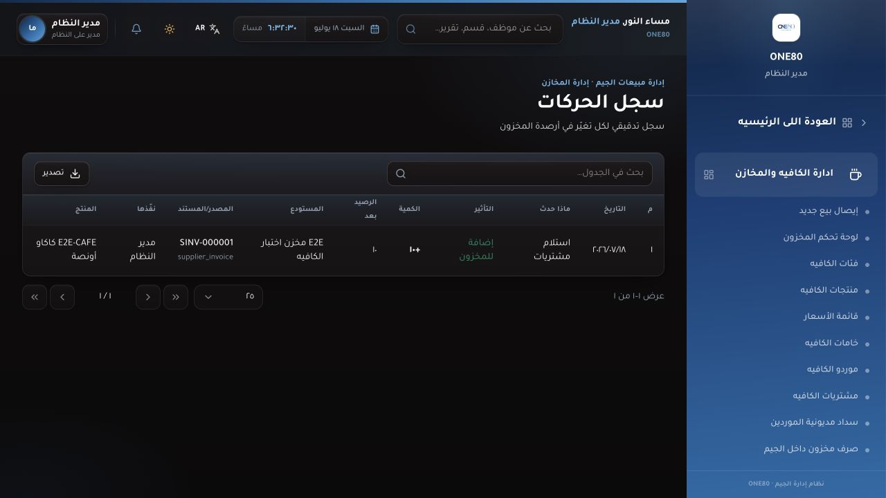

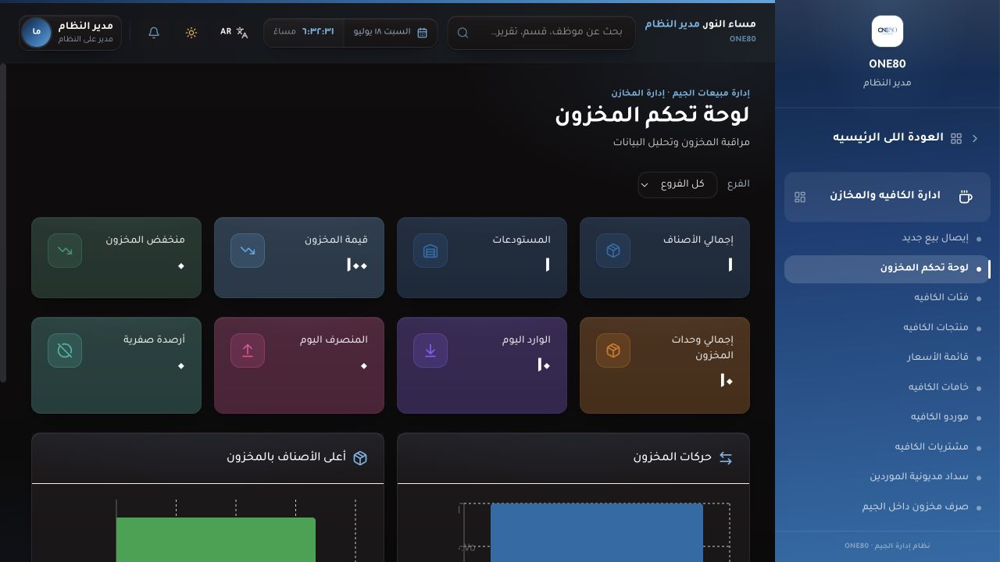

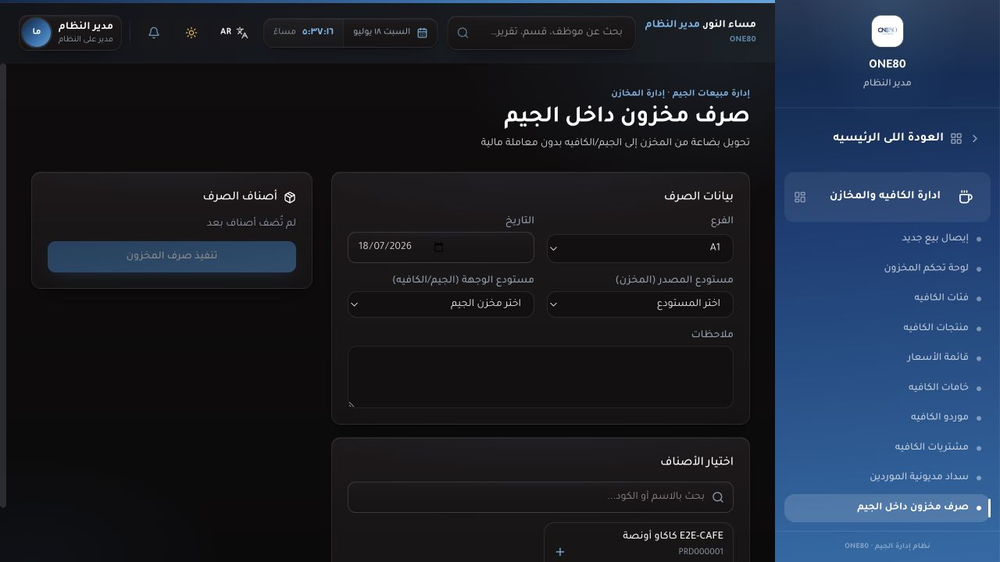

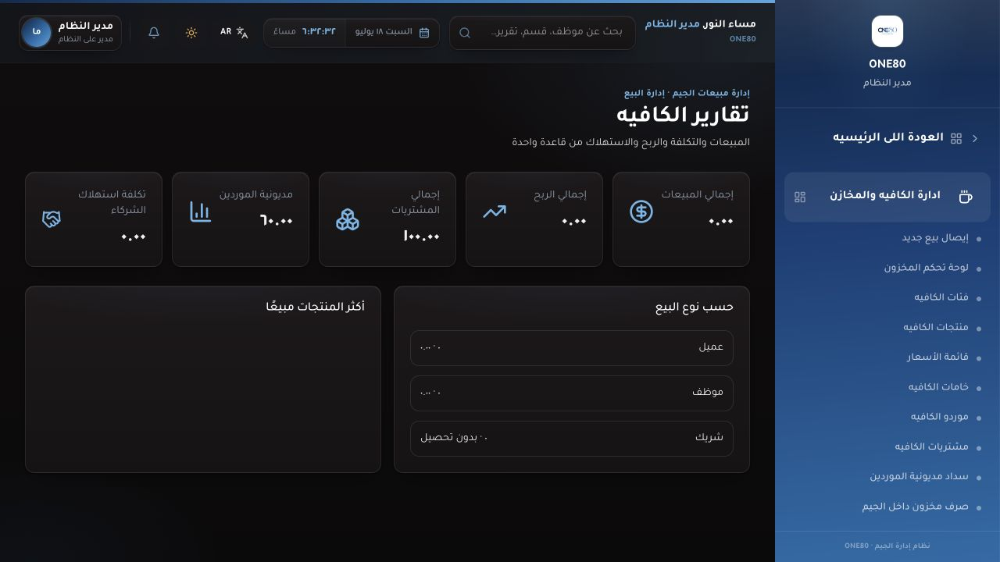

## ملاحظات النشر

- شغّل `npx prisma migrate deploy` على قاعدة ONE80 في السيرفر قبل تشغيل النسخة الجديدة.
- تأكد أن لكل فرع مستودعًا رئيسيًا واحدًا على الأقل؛ المشتريات والبيع يحتاجان مستودعًا لتسجيل الرصيد والحركات.
- ارفع مجلدات الصور/الـ uploads كـ persistent storage ولا تستبدلها أثناء deploy، حتى لا تختفي صور المنتجات أو الأعضاء.
- لا تشغّل seed أو reset على قاعدة السيرفر، لأنها تحتوي أعضاء واشتراكات حقيقية.
- احتفظ بنسخة احتياطية لقاعدة البيانات ومجلد الصور قبل أول نشر.

## الحكم النهائي

الدورة الأساسية للكافيه في ONE80 مترابطة وتعمل: **مورد ← شراء ← خامة ومخزون ← حركة ومديونية ← سداد ← جرد ولوحة وتقارير**. جميع الصفحات المطلوبة موجودة وتفتح بدون أخطاء قاعدة بيانات، والـ production builds ناجحة. بيانات الاختبار محلية ومميزة بوضوح ولا تمس بيانات الأعضاء أو الاشتراكات.
