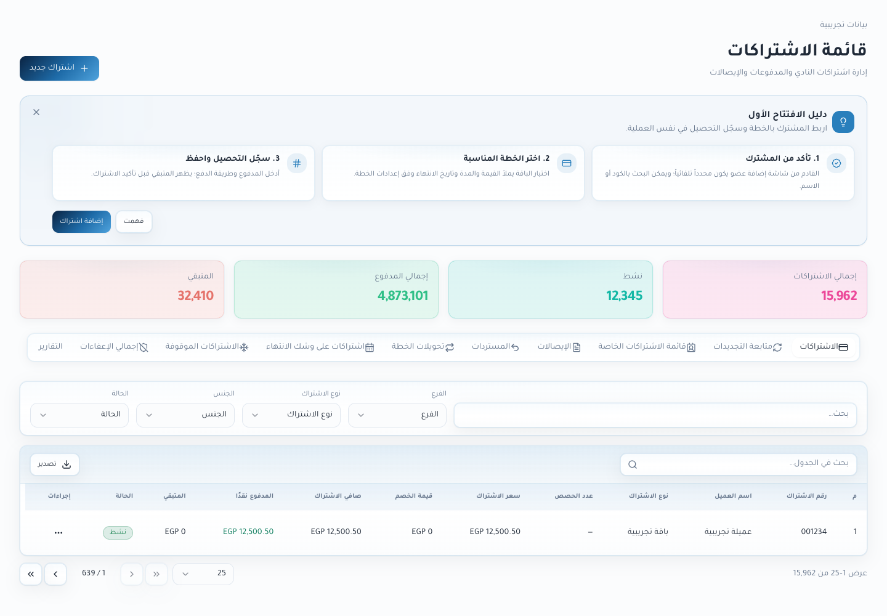
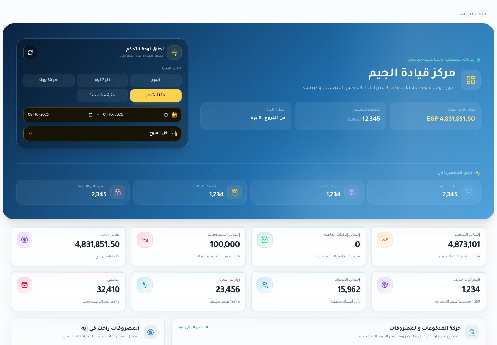
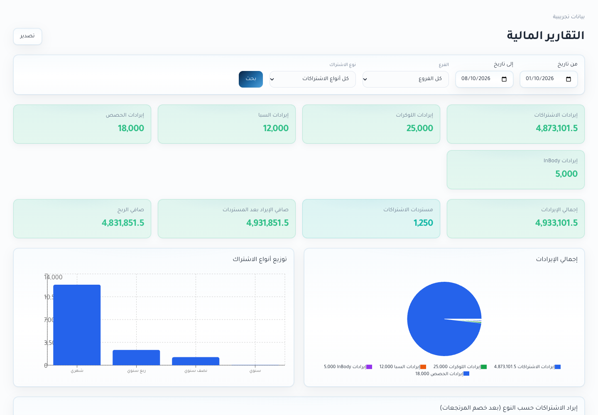

# فواصل الآلاف — one80 — 8 أكتوبر 2026

المبالغ والأعداد بتظهر بفاصلة كل 3 أرقام، زي `4,873,101`، في الكروت والجداول والتقارير والرسوم البيانية وتفاصيل الأسعار. الكسور بتفضل ظاهرة حسب تنسيق الصفحة الموجود. ملفات Excel بتعرض نفس الفواصل مع الاحتفاظ بالقيم الرقمية عشان الجمع والحسابات.

أكواد العضوية والاشتراك والإيصال والموبايل والهوية والتواريخ بتفضل بصيغتها الأصلية؛ الفواصل تخص الكميات والمبالغ المعروضة. حقول إدخال الأرقام وطلبات الحفظ وحسابات المبالغ لم تتغير.

## التنفيذ والمراجعة

- `frontend/src/lib/number-display.ts`: تنسيق العرض بدون تقريب الأجزاء العشرية.
- `frontend/src/lib/utils.ts` و`formatters.ts`: ربط التنسيق المشترك مع الاحتفاظ بلغة وأسلوب الأرقام الخاصين بالمشروع.
- البطاقات والجداول المشتركة، وخلايا وأوصاف الكميات، ومحاور الرسوم وتفاصيلها تستخدم التنسيق. أعمدة الأكواد تستثنى.
- تصدير Excel يحافظ على الأرقام كقيم رقمية ويضيف تنسيق الخلية فقط.
- المراجعة تستخدم مكونات الصفحات الفعلية مع بيانات تجريبية مستقلة، بالعربية والإنجليزية وعلى الموبايل. نتائجها في `.impeccable/review/number-grouping/browser-proof.json` وصور الموبايل والوضع الداكن في نفس المجلد.

## صور الصفحات الحالية — بيانات تجريبية

## التسليم التقني

التعديل في نسخة المشروع المحلية. لم يحدث اتصال بسيرفر الإنتاج أو نشر أو تغيير بيانات قاعدة البيانات ضمن هذه المهمة. نتائج البناء في `.impeccable/review/number-grouping/build.log`.
